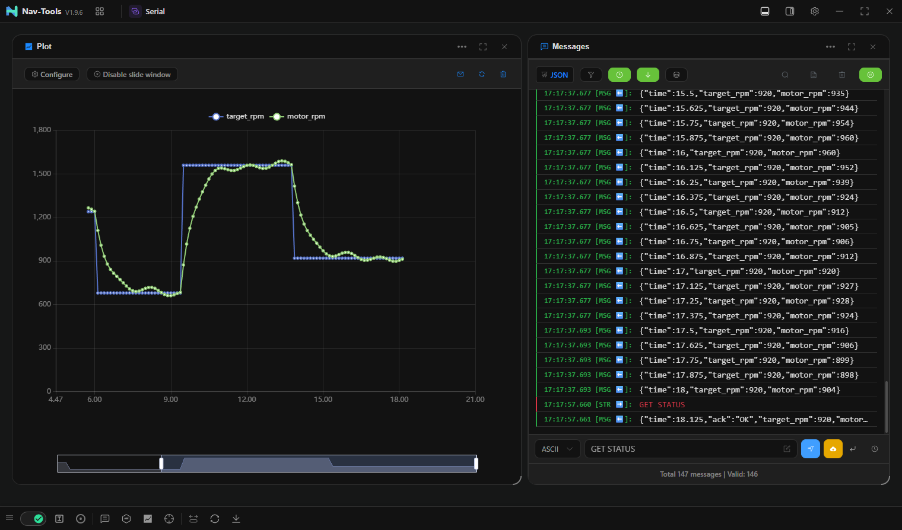
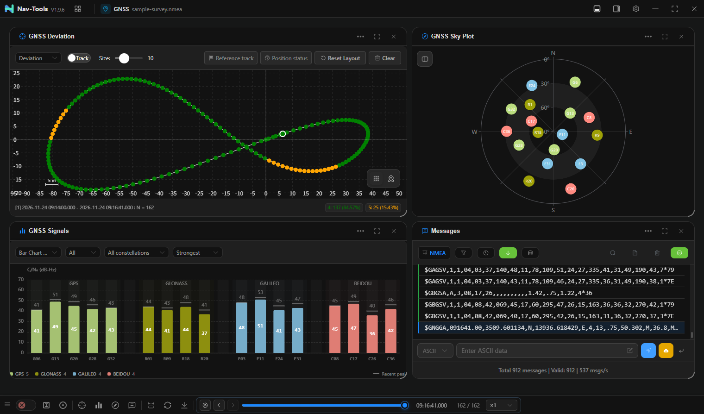

# Nav-Tools

**串口调试与 GNSS 数据分析工作台**

接上设备，边收发消息边看遥测曲线。拖入 GNSS 日志，沿时间轴查看轨迹、定位状态和卫星信号。

[**下载 Windows 版**](https://github.com/salmoshu/Nav-Tools/releases/latest) · [更新日志](release-notes.md)

## Serial · 串口调试

给设备发一条命令，在同一个工作区查看原始回复和数值变化。适合固件联调、台架测试和快速排查通信问题。

*示例使用模拟串口遥测。Plot 对比目标转速和实测转速，Messages 保留原始数据。*

- **收发消息** 支持 ASCII / HEX，可配置波特率、RTS / DTR 和循环发送频率。
- **观察曲线** 从 JSON、CSV 等数据中选取字段，支持单轴或双轴绘图。
- **排查通信** 筛选、暂停滚动或保存原始消息，把异常和对应的曲线变化对上。

## GNSS · 定位与卫星分析

接入串口、TCP 或 UDP 实时数据，也可以直接打开录制文件。轨迹、天空图、信号强度和原始消息可以一起看。

*示例使用同一份 NMEA 日志回放轨迹、卫星信号和原始消息。*

- **定位与回放** 沿时间轴查看轨迹、定位质量、速度和在用卫星数。轨迹可在网格与地图间切换，已浏览的地图瓦片可在重启后复用。
- **RTCM3 单点定位** 对具备观测数据和所需星历的实时流或文件运行内置 SPP，输出 GGA、RMC、GSV 和 GSA。
- **卫星与多频信号** 用天空图查看卫星位置，按频点或单颗卫星查看 C/N₀。可在全部卫星 `All` 和参与解算的卫星 `Used` 之间切换。

## 开始使用

从发布页下载 `Nav-Tools-Windows-*-Setup.exe`。安装后选择 **Serial** 或 **GNSS**，通过 `Input` 接入数据，也可以把日志拖入工作区。

其他工作区仍在完善。Nav-Tools 以 [MIT 许可证](LICENSE) 开源。
